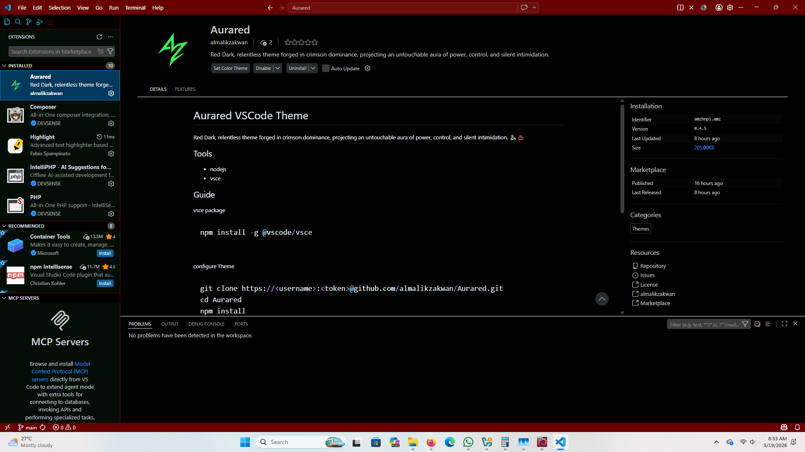
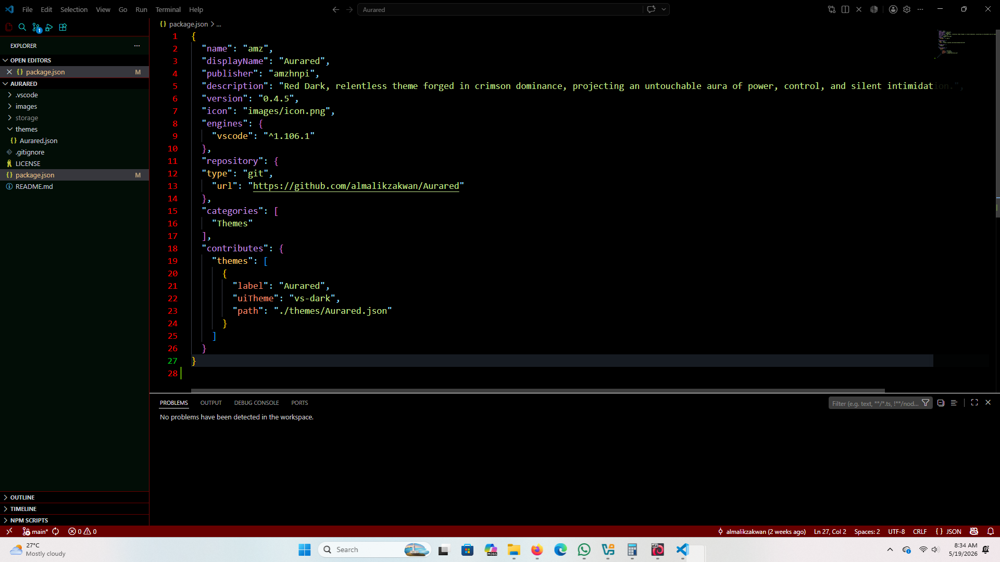

# Aurared VSCode Theme

Red Dark, relentless theme forged in crimson dominance, projecting an untouchable aura of power, control, and silent intimidation. 🐉♨️

## Sample Screenshot

<hr>  


## Tools  
- nodejs
- vsce 

## Guide  
vsce package  
```powershell
npm install -g @vscode/vsce
```  
configure Theme 
```powershell
git clone https://<username>:<token>@github.com/almalikzakwan/Aurared.git
cd Aurared
npm install
vsce package
code --install-extension .\amz-{version}.vsix
```  

or you can download and install extension file (.vsix) from releases
```powershell
code --install-extension .\amz-{version}.vsix
```

This theme also available at *Visual Studio Code Extension Marketplace*. 

## LICENSE
This project using non-commercial software license. 

**Enjoy!**
